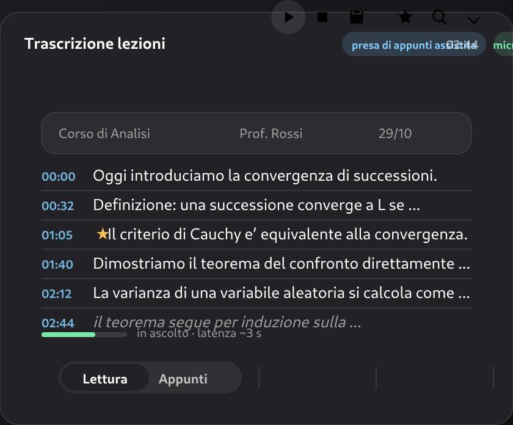
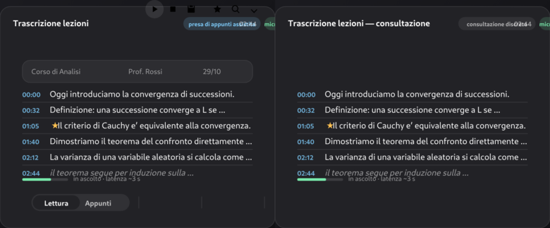

# Lecture Transcriber

Trascrizione **in locale** delle lezioni universitarie per Fedora Linux /
GNOME Wayland. Una finestra flottante semitrasparente che trascrive ciò che
dice il professore mentre tu prendi appunti in LibreOffice, Obsidian o un
qualsiasi editor.

> **Nessun dato lascia il computer.** Nessun account, nessun servizio cloud, nessun
> privilegio di amministratore per le funzioni essenziali.

       

<p align="center">
  
</p>

<p align="center">
  <em>La finestra flottante: trascrive la lezione mentre prendi appunti. Le due modalità si richiamano con un tap.</em>
</p>

### Due modalità, una finestra

| | Presa di appunti assistita | Consultazione discreta |
|---|---|---|
| **Cosa fa** | Interattiva, con barra dei comandi e controlli di ascolto | Sola lettura: semitrasparente, minimale |
| **Quando** | Quando trascrivi e vuoi inserire, segnalibri e note | Quando ripassi, cerchi o rileggi |

<p align="center">
  
</p>

**Fedora / GNOME / Wayland** · **Python 3.14** · **Whisper in locale** · **MIT**

---

## Cosa fa

- **Trascrive in tempo reale in italiano**, interamente sul computer, con
  Whisper (`large-v3-turbo` int8, circa 2 GB di RAM).
- **Finestra flottante** che si puo' spostare, ridimensionare, compattare e
  rendere semitrasparente; resta visibile sopra il programma di scrittura.
- **Due modalita' distinte**: *consultazione discreta* (semitrasparente, per
  leggere) e *presa di appunti assistita* (interattiva, con i controlli).
- **Cronologia consultabile** con ricerca, timestamp per segmento, segnalibri
  e note rapide.
- **Inserimento controllato** nel documento: disattivato di default, e quando
  e' attivo scrive solo nella finestra che avevi registrato.
- **Scorciatoie globali** (via il `media-keys` di GSettings), configurabili.
- **Export** in TXT, Markdown, Markdown con timestamp e SRT.
- **Salvataggio automatico** in SQLite: nessuna lezione persa.

---

## Installazione

Da un PC qualsiasi con **Fedora 44** (o simile con GTK4/libadwaita):

```bash
git clone https://github.com/neokov/lecture-transcriber.git
cd lecture-transcriber
./scripts/install.sh
```

Fatto. L'app compare nel menu delle applicazioni come
**"Trascrizione Lezioni"** e si apre con un tap.

`install.sh` lavora **senza root**: crea il virtualenv, installa le
dipendenze Python, scrive il launcher in `~/.local/bin` e installa
l'estensione GNOME. Le uniche due cose che puo' chiederti sono i pacchetti
di sistema, se mancano:

```bash
sudo dnf install python3-gobject gtk4 libadwaita
```

Per avviarla a mano (o per verificare che sia tutto a posto), uno di questi
due — funzionano da **qualsiasi** cartella:

```bash
lecture-transcriber                                   # il launcher
~/lecture-transcriber/.venv/bin/python -m lecture_transcriber   # diretto
```

Istruzioni complete, la configurazione e la disinstallazione:
**[docs/installazione.md](docs/installazione.md)**.

---

## Come funziona

```
microfono (PipeWire, 48 kHz)
    │  downmix mono + resample 16 kHz (soxr)
    ▼
VAD a inviluppo RMS  ──── silenzio ≥ 700 ms ───▶  chiude il segmento
    │
    ▼
Whisper int8 (large-v3-turbo)  ───▶  testo provvisorio (live) + testo finale
    │
    ├──▶ SQLite (autosave) ──▶ cronologia, ricerca, segnalibri
    └──▶ inserimento (solo se attivo e la finestra non e' cambiata)
```

La **decodifica Whisper dura ~3 secondi** ed e' costante (la finestra e'
sempre di 30 s): e' la latenza reale fra la fine di una frase e la sua
comparsa. L'ipotesi provvisoria mostra le prime parole prima.

Esiste anche un ASR **streaming** italiano (Zipformer2, RTF 0,017: prima
ipotesi in 40 ms), ma ha WER 19,1 % contro 7,0 %, non produce punteggiatura
ed e' licenziato CC-BY-SA, incompatibile con la MIT di questo progetto.
Whisper resta il motore del testo definitivo — vedi
[docs/analisi-fattibilita.md](docs/analisi-fattibilita.md) §3.1 e le
[misure](research/streaming-asr-italiano-misure.md).

---

## Limiti reali su GNOME 50 (Wayland)

Non tutte le funzionalita' classiche sono disponibili. Sono state verificate
per ispezione del binario e test dal vivo, non assunte:

| Funzionalita' | Stato |
|---|---|
| Semitrasparenza | ✅ `set_opacity` |
| Sempre in primo piano | ⚠️ **serve l'estensione GNOME** in `shell-extension/` |
| Click-through (clic ignorati) | ❌ impossibile su GNOME 50 Wayland |
| Blur di sfondo | ❌ arriva solo con GNOME 51 |
| Scorciatoie globali | ✅ via GSettings `media-keys` (verificato) |
| Inserimento in LibreOffice Writer | ✅ API UNO (verificato) |
| Inserimento in editor GTK | ✅ at-spi (verificato) |
| Inserimento in Obsidian / VS Code | ⚠️ serve `ydotool` (una regola udev, con `sudo`) |
| `wtype` | ❌ mutter non espone i globali necessari |

Le alternative proposte al posto delle funzioni impossibili sono descritte in
**[docs/analisi-fattibilita.md](docs/analisi-fattibilita.md)**, che contiene
anche la matrice di affidabilita' per applicazione.

---

## Struttura del progetto

```
src/lecture_transcriber/
    config.py      preferenze e percorsi XDG
    audio.py       cattura PipeWire, resampling, meter di livello
    asr.py         motore Whisper + segmentatore a VAD
    sessions.py    archivio SQLite (sessioni, segmenti, segnalibri, note)
    insertion.py   inserimento UNO / at-spi / ydotool / clipboard
    export.py      esportazione TXT, Markdown, SRT
    study.py       riepilogo, concetti, definizioni, flashcard, dizionario
    shortcuts.py         scorciatoie globali via portal GlobalShortcuts
    shortcuts_gsettings.py  scorciatoie globali via GSettings media-keys
    ui.py          finestra flottante GTK4 + libadwaita
    app.py         orchestrazione: worker di cattura, ASR e inserimento
shell-extension/  estensione GNOME per il sempre-in-primo-piano
scripts/          installazione, benchmark, test end-to-end
tests/            test automatici
docs/             analisi di fattibilita', installazione, test
packaging/        specifica RPM per Fedora
```

---

## Sviluppo

```bash
# test automatici
.venv/bin/python -m pytest tests/ -v

# benchmark dei modelli su questa macchina
.venv/bin/python scripts/bench.py

# test end-to-end del motore ASR
.venv/bin/python scripts/test_asr_italian.py
```

Il progetto richiede **Python 3.14**: e' l'unico interprete con `gi`, `uno`
e `Atspi` di sistema su Fedora 44, e `uno`/`Atspi` sono la via obbligata per
l'inserimento del testo.

## Licenza

MIT.
